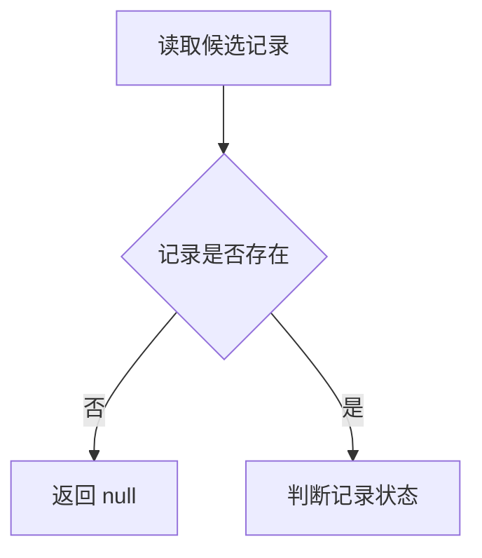

# Technical design writing and review rules

## Document purpose

A technical design turns confirmed requirements and design decisions into code-backed, implementation-ready change instructions for engineers and reviewers. Implementers must understand the goals, owning services and modules, change locations, key rules, and boundary behavior. Reviewers must be able to assess requirements coverage, design consistency, and expected outcomes.

Sections, tables, and length guidance serve implementation comprehension, not template completion. The document does not replace requirements analysis, record exploration history, or seek exhaustive code listings. Do not leave verifiable key implementation details for implementers to rediscover or infer.

## Entry points

1. Read the [technical design template](../templates/technical-design.md). Also read the original when updating or reviewing an existing design.
2. Writing/updating: check that confirmed scope, design decisions, and evidence cover this implementation. Verify anything answerable from existing requirements, code, configuration, or dependency information first; do not substitute “待确认” or “待核验” for investigation. If verification is missing, complete it through the design workflow before organizing the body. Fill the template using these rules, remove empty conditional subsections, prompts, and placeholders, then perform the body self-check.
3. Checking/reviewing: identify issues using these rules and the body self-check, with locatable source positions, specific impacts, and recommendations. Use the template only as a review reference; do not force it onto the document or modify the original. Follow the write/update workflow when the user explicitly requests changes.

This reference governs writing and reviewing the body. Follow the [design workflow](design-workflow.md) for requirements analysis, code verification, output paths, and save authorization. Reuse applicable project coding conventions without redefining them.

## Template and metadata

- Include only `tags` and `date` in template frontmatter.
- Set `date` and the design date to the actual design date in `YYYY-MM-DD` format.
- Preserve valid requirement sources, tags, and links. Replace or remove body placeholders and omit template-instruction comments from output.

## Scope and evidence

- Expand only this implementation's content. State necessary scope boundaries as final conditions; do not record discussion history or list rejected alternatives.
- “This implementation's content” means the complete target design within confirmed requirements, not just unfinished work. After partial implementation or early release, preserve valid design and original add/modify/delete descriptions. Do not remove completed parts from scope, require recasting them as implemented capabilities, or require post-implementation source citations.
- Integrate only confirmed changes to requirements, final design, or key contracts. Exclude intermediate implementations, temporary solutions, development progress, and release records. Implementation/design differences are not automatically design changes. Ask the user if inclusion in the final design is unclear; follow “Updating an existing design” in the workflow for verification and updates.
- Support current facts, risk conclusions, and optimization items with requirements, project code, configuration, or confirmed external contracts.
- List an item under What's “待确认事项” only if relevant verification still cannot resolve it, or missing access, projects, versions, or other prerequisites prevent verification, and it blocks implementation. State the specific question, checked scope or unavailable prerequisites, reason it remains unresolved, missing information, and concrete impact, without investigation logs. Ask explicit questions for business decisions rather than filling gaps by speculation. Remove unknowns that do not block this implementation.
- Do not mix unconfirmed, excluded, or future-optimization content into current goals, flows, code changes, examples, or acceptance criteria. Create a separate future-optimization design only on explicit request.
- Use file paths relative to the owning repository root (“repository-relative paths”) for source evidence, code changes, version declarations, and proposed file targets. Preserve the complete directory hierarchy; do not use local absolute paths, bare filenames, or omitted intermediate directories. Identify the owning project for cross-repository references; avoid repeating the project prefix when a table already has a project column. This does not change document output/save path requirements.
- Cite existing code as `ClassName.methodName() @ repository-relative-path:line`, for example `OrderService.create() @ src/main/java/com/example/OrderService.java:42`. Use target repository-relative paths for proposed files without inventing line numbers. Keep only directly implementation-relevant evidence. Briefly state or cite necessary existing contracts, permissions, transaction rules, and cache rules where relevant; omit unrelated current-state details.

## Fixed structure and length

The final document has exactly four top-level body sections beneath its title: `What`, `Why`, `How`, and `Example`. Follow the template's numbering and heading hierarchy. Do not add summary, implementation, testing, decision-record, operations, risk-list, traceability-matrix, or design-status sections.

### Section and subsection purposes

Use this table to place content. Purpose descriptions guide writing; they are not fixed paragraphs in the final document. Preserve the Chinese deliverable labels shown below.

| Section or subsection | Reader question to answer |
|---|---|
| What | What does this change achieve, and where are its implementation boundaries? |
| 改什么 | Which business behaviors or capabilities change after implementation? Do not introduce implementation details yet. |
| 范围 | Which projects, modules, and changes are involved, and which necessary boundaries remain unchanged? |
| 待确认事项 | Which verified-but-unresolved questions still block implementation, and what information or decisions are needed? |
| Why | Which verified current facts and necessary constraints make this change necessary, and how do they shape the design? Do not restate goals or general value. |
| How | How does the design implement the goal with clear responsibilities and explicit contracts? |
| 处理流程 | What is the entry point, execution order, and path through key branches and collaboration to the result? Prefer flowcharts. |
| 核心规则与实现 | How are key conditions evaluated, data and state changed, mechanisms applied, and reused/new capabilities coordinated? Prefer text trees for local branches; add code for precision as needed. |
| 辅助方法与规则 | Which necessary new business-method contracts and logic omitted from the main flow need explanation? Do not mechanically list private methods. |
| 接口 | How can both parties implement and integrate independently using service ownership, parameters, results, errors, and compatibility contracts? |
| RPC 依赖版本 | Which dependency declarations must change with a public contract so providers and callers use consistent contracts? |
| 数据库 | How do persistence structures, constraints, and access support these business rules? |
| 缓存 | What are the cache contents and lifecycle, and how do hits, invalidation, and errors affect business results? |
| 消息 | Which structure and delivery agreements govern producers and consumers, and how do asynchronous processing and failures connect to the business flow? |
| 外部配置 | What changes in the configuration center, how is it located, populated, and activated, and how do values affect behavior? |
| 代码改动 | Which actually changed files and symbols implement the design, and are necessary changes covered? Do not repeat detailed design. |
| Example | Do concrete inputs and observable results demonstrate a complete, consistent design that meets the goals? |
| 正常示例 | How do normal inputs pass through key processing and necessary data changes to produce the target result? |
| 边界示例 | Which key conditions, errors, or boundaries produce different results, and what is expected? |

### Length guidance

| Content | Budget |
|---|---:|
| What goals | Usually at most 3 items |
| What scope | Usually at most 3 items; add necessary non-goals only when they affect implementation understanding |
| Why | Usually at most 3 sentences and 3 evidence rows |
| Core rules | Usually at most 8 items |
| One processing scenario | Usually at most 8 steps |
| One interface purpose | 1 sentence |
| One interface's processing rules | Usually at most 5 items |
| One interface's errors and compatibility | Usually at most 3 items |
| One code block | Usually at most 40 lines; up to 60 when a complex local algorithm genuinely requires it |
| Example | Usually 1 normal example; add the minimum sufficient examples for independent scenarios and key boundaries |
| Unresolved questions | Usually at most 5 items; remove when absent |

These budgets default to one requirement item or business scenario. For complete requirements with multiple scenarios, apply step, rule, and interface budgets per scenario and share common content. Expand What goals and scope as warranted by the complete requirements. Interface fields, table fields, and enum values have no item limit and must be complete. Completeness, implementability, and verifiable acceptance take precedence over length targets; never omit requirement items, business rules, boundaries, fields, or unresolved questions just to meet a budget.

## Representation requirements

Use only flowcharts for diagrams. Choose representations by content to avoid long prose and repeated diagram/text descriptions:

| Content | Representation |
|---|---|
| Overall processing, cross-step collaboration, loops, or complex execution paths | Flowcharts; short numbered steps for simple linear logic, not flow tables |
| Local conditional branches around one decision subject | Text tree listing conditions and corresponding behavior directly, with nested decisions as needed |
| Calling conventions, state-transition rules, entity associations, and deployment relationships | Prose, tables, or code |
| Necessary business rules not expressed in diagrams | Short list, one rule per item |
| Interface fields, data structures, and code changes | Tables |
| Calls, algorithms, or mechanisms needing precision | Concise target-language pseudocode or real code emphasizing key calls; do not require code for every rule |

- Keep explanatory paragraphs to usually at most 3 sentences. Organize complex content by topic rather than merely splitting a mixed passage into shorter paragraphs; preserve necessary information.
- Choose the primary representation according to the reader's question: flowcharts for overall paths, text trees for local decisions, code for precise mechanisms. Do not give the same logic a diagram, tree, and code by default. Once a representation guides implementation adequately, do not repeat every item; use other forms only for necessary missing information.
- Reserve tables for item-by-item comparison such as interface fields, structured data, and code changes. Use short lists or numbered steps for general explanations and business flows.

1. Express one fact per sentence and one action per flow step.
2. State a conclusion once; refer to its heading later instead of rephrasing it. Follow global `Writing and Updating` principles. Limit Why to current problems and necessary constraints.
3. Exclude industry background, generic technical knowledge, inflated business-value claims, architectural philosophy, and analysis with no code impact.
4. Avoid filler such as “另一方面”, “综上所述”, “值得注意的是”, “为了进一步提升”, “从长远来看”, “赋能”, and “抓手”.
5. Do not use status/governance terms such as `READY`, `PARTIAL`, `BLOCKED`, `DEFER`, “冻结”, or “门禁”. Put unconfirmed content meeting the scope/evidence criteria only in unresolved questions, not goals, scope, flows, code changes, examples, or acceptance criteria.
6. Do not include performance, capacity, deployment, staged rollout, monitoring, alerts, owners, or operations by default. When explicitly required and relevant to this implementation, put necessary design in the appropriate How subsection as prose, tables, or code, stating only concrete implementation-affecting rules.
7. Do not produce standalone test matrices, implementation sequences, or process logs. Put observable acceptance outcomes in Example rather than adding a completion-criteria section.

### Topic organization and supplementary content

- Determine topic ownership from the complete document's goals, scope, section responsibilities, and cross-section relationships before choosing a primary representation. Group implementation information accordingly, keeping the conditions, actions, outcomes, and boundaries of one rule together; do not treat diagrams, trees, or tables as a first draft followed by a prose remainder.
- When adding or revising information, locate its owning topic first. Update the corresponding flow, rule tree, or contract when the information changes or completes it. Do not preserve an incomplete representation and explain the missing logic afterward.
- Keep supplementary prose only for definitions, implementation mappings, rationale, or precise details not already expressed by the primary representation. Keep it beside the content it explains; a short clarification does not require a separate heading.
- Give a genuinely independent topic a short, descriptive heading, or move it to an existing matching subsection. Do not use headings merely to divide a mixed passage without resolving content ownership.
- State each rule once in its owning location. Reference it elsewhere when needed. Examples may demonstrate the rule with concrete inputs and outcomes without repeating its definition.

## How requirements

### Flowcharts

- Provide a flowchart in the corresponding processing scenario for cross-step collaboration, loops, or complex execution paths; simple linear logic may use short numbered steps. Put local branches fully explainable around one decision subject in core rules and implementation as a text tree. Branching alone does not require a diagram.
- Explain how one business process runs from start to finish and how conditions lead to results. Include the business entry, key actions, decisions, branch destinations, necessary loops, and final outcomes. Do not mix in component architecture, call payloads, or unrelated implementation details.
- Start every chart independently at an explicit business entry and show its complete flow. Do not attach its entry to another chart's end or require readers to stitch charts together. When diagramming multiple scenarios separately, state each trigger and outcome.

#### Readability and technical expression

- Use `mermaid` fenced blocks with the compatible syntax below.
- Give each chart a title naming its specific business topic. Readers must understand its central question directly from the title, nodes, and edges without first reading code or long explanations.
- Focus each chart on one business flow and show the business main path first. Maintain a consistent abstraction level; do not mix services, classes, methods, and local operations as peers.
- Add technical names only when needed for understanding or locating implementation, consistent with real services, modules, interfaces, states, and entities in the body. Map class names, method names, and source paths after the chart if useful. Do not replace business explanations with piles of implementation names. Mark proposed additions clearly without hiding business names or responsibilities. Do not invent existing components, relationships, states, or deployment environments.
- Nodes, edges, and labels must independently explain key logic. Label decisions and destinations; for calls, identify the executor, order, and necessary synchronous/asynchronous behavior. Component boxes without processing logic do not constitute a design.
- Show only what is needed to understand this design, not unrelated components for system completeness. Explain complex local rules in adjacent prose, tables, or code rather than splitting them into end-to-start charts.
- Diagrams do not replace interface fields, enums, exact conditions, SQL, indexes, cache contracts, or message contracts. Define these in their owning topics and reference them from the flow when needed. Keep only necessary clarifications beside the chart; follow the topic-organization rules rather than appending an equivalent prose flow.

#### Mermaid-compatible syntax

- Default to `graph TD;`, not `flowchart TD`. Use `graph LR;` when horizontal layout is genuinely needed.
- End graph declarations, node declarations, and edge statements with `;`, with one statement per line. Explicit statement boundaries reduce parsing issues when line breaks are transformed. Do not put terminators inside node labels.
- Use node IDs starting with an English letter and containing letters, digits, or underscores, such as `A` or `checkState`. Avoid syntax keywords such as `end`. Put Chinese and special characters in double-quoted labels, such as `A["读取候选记录"]` and `B{"记录是否存在"}`.
- Use traditional rectangles, rounded rectangles, diamonds, and basic arrows. Avoid version-specific shapes, icons, animation, and complex styling. Do not depend on initialization directives, HTML tags, or host-specific configuration for essential content. Shorten long labels or split them into business actions rather than relying on HTML line breaks.
- Compatibility depends on the actual Mermaid version in the target host. Verify against it when known and render in the target host when available. If the version or rendering environment is unknown, state only that basic compatible syntax was used; do not claim rendering validation for a particular version.

Basic example:



### Processing flow

- Prefer flowcharts for overall business execution paths and expand local branches in core rules and implementation. Supplement exact calling and state-transition rules at the appropriate location with prose, tables, or code.
- Show the entry, key actions, input conditions, necessary data changes, and results. Favor business meaning in node and message labels. Put key executing classes/methods and source references after the chart, mapping capabilities without restating every step.
- For simple linear logic, short numbered steps alone suffice. Each step identifies the executing class/method and one action, plus input conditions, data changes, or return results needed to understand it. Do not use flow tables.
- For multiple scenarios, describe only real differences; state common steps once.
- Include transactions, locks, idempotency, fallback, and exceptions in the corresponding step only when they change business outcomes.
- When a local branch is fully explained in a text tree, retain only the corresponding business action in the overall flow and reference the rule rather than copying the tree into the chart. Omit a standalone processing-flow subsection for simple scenarios when the rule tree alone establishes entry, processing, and outcome.

### Core rules and implementation

- Organize by rule topic first. Prefer the text-tree format below for local branches, short lists for independent constraints, and code for precise mechanisms as needed. Do not impose a fixed condition/result/code pattern or require pseudocode for every rule.
- Give verified, concrete implementation mechanisms. Use real fields, complete SQL, or precise operations for interface contracts, data access, SQL, and middleware operations. Method signatures alone are not implementation evidence.

#### Text trees

- Use a `text` fenced block with `├─`, `└─`, and `│`, preserving indentation. This is a textual rule representation, not a flowchart or target-language pseudocode.
- Name an explicit decision subject or action at the root. Express branches as “condition: behavior or result”. Child branches apply only when their parent condition holds. Siblings do not imply sequential execution; state evaluation order explicitly when match priority matters.
- Use real states, fields, and exact boundaries. Cover the rule's applicable scope and identify the target of skipping, returning, continuing, and data changes. Add definitions when names alone do not establish behavior; do not substitute phrases such as “按原逻辑” for unexplained key rules.
- Focus on one local decision. Use flowcharts for overall paths involving multiple subsequent independent steps, loops, branch convergence, or cross-service collaboration. Do not use indentation as a substitute for execution order.
- State exact conditions and operations directly when the tree can express them. Reference adjacent definitions for SQL, cache contracts, method collaboration, or algorithms requiring separate treatment. Add only missing information, not equivalent code. Put key executing classes, reuse/proposed-addition labels, and source locations around the tree rather than in every node.

Format example (hierarchy only; replace with verified conditions and behavior in an actual design):

```text
读取候选记录
├─ 记录不存在：返回 null
├─ 记录已消费：返回 null
└─ 记录未消费：判断失效时间
   ├─ 当前时间 >= expireTime：返回 null
   └─ 当前时间 < expireTime：返回候选记录
```

#### Code representation

- Use the target project's language syntax, types, method signatures, calls, and control structures for pseudocode; do not disguise natural-language steps as code. Match the fenced language label to the target language.
- Follow project conventions and applicable coding skills, including naming, responsibility separation, dependency injection, branching, and exception handling. Pseudocode does not relax these standards.
- Organize pseudocode to production-code design standards, simplifying only for design presentation. First establish layers/classes, method responsibilities, and dependencies from project conventions and similar implementations, then expand key logic. Express ownership in block titles, adjacent descriptions, or code; a complete class listing is not mandatory.
- Prefer thin orchestration pseudocode: show the entry, key reused calls, proposed business-method names, and data flow without expanding mechanical field assignments, Stream/collection conversions, getters/setters, or imports. Preserve necessary responsibility separation, dependency usage, key branches, exception behavior, call order, and transaction boundaries affecting outcomes. Do not shorten code by putting unrelated responsibilities into the entry method.
- Use responsibility-specific proposed method names and verified existing types or explicitly labeled proposed types for key inputs and outputs. Method comments include only applicable implementation-affecting dimensions, such as query scope, required parameters, Boolean conditions, null behavior, batch limits, idempotency keys, transaction boundaries, or message boundaries. Do not add empty explanations for irrelevant dimensions.
- Verify actual names, signatures, and semantics of existing types and methods; label existing calls as reuse. Clearly label proposed types and methods as new or proposed, with responsibilities, target paths, and key fields or signatures. Do not present them as existing capabilities. Reference definitions already covered by field tables or code changes rather than repeating them.
- Omit only mechanical implementation, not key business rules, branches, exception behavior, or data flow. Comments cannot replace key processing logic, and helper names cannot replace necessary contracts and rules. Explain new business methods omitted from the main flow under “辅助方法与规则”; reference existing definitions directly.
- Do not expand ordinary deduplication, mapping, batching, or object assembly line by line merely for display, or force them into small methods without business responsibility. Use real target-language code for complex algorithms, key concurrency, transaction boundaries, or error-prone local logic when useful.
- Do not invent existing types or signatures, use `TODO` or `...`, omit key branches, or provide only vague comments such as “查询数据、校验合法、处理结果” that cannot guide implementation.
- Verify required existing types, signatures, and blocking rules according to the entry-point instructions first. If still unconfirmed, apply the scope/evidence rules rather than fabricating code.

### Interfaces

- Document only HTTP, Dubbo, or other interfaces added, modified, or deleted by this requirement.
- Give each interface its own subsection titled by method/path or complete method signature. Under it, identify the owning service and project/module, then state its purpose in one sentence.
- The owning service is the service providing the interface, regardless of whether the Provider or Consumer changes. Verify its name from code or configuration; do not infer it from a project name.
- Describe requests and responses for added or modified interfaces in separate field tables. Include field path, type, required-on-request or guaranteed-on-response status, nullability, change type, business meaning, and enum/example. Also identify actual parameter locations for request fields. State omission behavior for optional fields; distinguish empty strings, empty arrays, and null when outcomes differ.
- List every field for new interfaces and added/modified/deleted fields for changed ones. For whole-interface deletion, explain the original contract, replacement if any, and post-deletion call outcome; do not require all original fields or normal request/response examples.
- Recursively expand added or modified objects and array elements to every leaf field, such as `result.items[].id`. A top-level object row does not replace its fields; there is no field-count limit.
- For every added or modified interface, provide one complete post-change call/result example in its real transport format. Use JSON for JSON payloads and appropriate forms for paths, query parameters, headers, forms, files, streams, or RPC parameters. Explicitly state absence of a request or response body rather than substituting an empty object.
- Changed fields in examples must agree with the difference tables. Unchanged fields may appear only in complete examples; deleted fields must not appear in post-change payloads.
- Focus Provider/Consumer changes, authentication, errors, and compatibility on this change and concrete behavior. Preserve directly implementation-relevant existing constraints under the scope/evidence rules.
- Separate responsibilities within an interface subsection: purpose states the business action; processing rules add interface-specific conditions and behavior, referencing shared core rules; field tables define the data contract; request/response examples show concrete call forms; errors/compatibility explain failure behavior and impact on existing callers.
- For RPC public-contract additions, modifications, or deletions, add an “RPC 依赖版本” table in the interface subsection. List dependency coordinates, current/target versions, and declaration locations for the Provider contract module and every affected Consumer. Follow existing project version rules. If rules remain unverifiable after investigation or prerequisites are missing, apply scope/evidence rules rather than inventing a target version. Remove this table for Provider-internal-only implementation changes.

### Data, caches, and messages

- Fully define new tables, cache values, and message structures. For changed structures, list additions, modifications, and deletions, preserving necessary existing constraints under scope/evidence rules. Recursively expand fields to leaves with types, nullability, business meaning, and applicable required status, defaults, or enums.
- Clarify database ownership, cache-reading/writing services, and message-producing/consuming services across services or where names are ambiguous. Verify names from code or configuration.
- Specify exact database fields, constraints, SQL, indexes, and read/write timing. Describe only; do not execute database operations.
- Fully qualify `CREATE TABLE` names as `数据库名`.`表名`, enclosing database and table names separately in backticks.
- Field comments describe field meaning only; state-field comments may include enum values and brief Chinese meanings. Put state transitions, isolation, overwrite behavior, and other business rules in the body, not SQL comments.
- Specify complete cache keys, values, TTLs, writes, overwrites, deletion, hits, misses, and error behavior.
- Specify exact message Topic/Queue, Producer, Consumer, delivery timing, and business outcomes on failure. Use a separate field table, full fields for new messages, and differences for modified messages.
- Remove categories neither involved nor relevant to implementation rather than writing “无变更”.

### External configuration

- Keep a standalone subsection when configuration is added, modified, or deleted in an external configuration center. Reference unchanged but directly relevant configuration in core rules; do not list unrelated configuration.
- Organize items by owning service and configuration location. Follow the project's actual mechanism and give the configuration center plus required namespace, group, configuration set, or other location details. Do not assume a platform or impose inapplicable hierarchy. Verify existing names, reading locations, defaults, and activation mechanisms; label proposed additions explicitly.
- List exact keys, change types, value types, business meaning, ranges/enums, applicable units, defaults, and behavior when absent. State explicitly when there is no default. Distinguish code defaults from values proposed for the configuration center; examples are not defaults.
- Fully define new configuration. List differences and necessary existing constraints for modifications. Explain business behavior after deletion. Recursively expand objects/arrays to leaf fields using full definitions for additions and differences for changes, including required status, nullability, and omission behavior.
- Specify null/invalid-value handling and the actual startup-read, restart-required, or dynamic-refresh mechanism. For dynamic refresh, explain the scope affected after updates. Configuration-center push support alone does not prove that values read by business code update dynamically.
- For added or changed configuration, provide complete relevant examples in the center's actual storage format, directly usable or mergeable into the corresponding configuration set. Do not replace necessary structure with isolated fields or expand unrelated set contents. Deleted items must not appear in post-change examples.
- Reference configuration keys in core rules and explain outcome-affecting values and branches. In Example, use concrete values covering key conditions with different business outcomes rather than repeating configuration definitions.
- Record configuration-center changes directly here, not as repository configuration-file changes, and do not invent repository paths. Include reading code or repository configuration files in the code-change table only if they actually change.

### Code changes

- List only files added, modified, or deleted by this requirement's final design. Do not derive scope from current workspace diffs or remaining work; retain already implemented or released changes. State responsibilities of new capabilities. Explain specific existing capability gaps only when needed for implementation understanding. Label and cite unchanged reused capabilities with repository-relative paths and symbols in flows or core implementation, not in the change table.
- Use one row per changed file: project, change type, symbol, one concrete change sentence, and repository-relative path as the last column.
- For RPC public-contract additions, modifications, or deletions, include version-declaration files for the Provider contract module and every affected Consumer.
- Do not repeat flow, interface-field, or code-block contents in the list. Put code evidence, code locations, declaration locations, and repository-relative paths in the last column of every table.

## Example requirements

- Use concrete inputs throughout the request/event, key processing, actual data changes, and final response or observable result. Do not invent data changes or response bodies where none exist.
- Usually start with one normal example. Add the minimum sufficient examples for independent scenarios or key boundaries with different outcomes, making observable expectations explicit without repeating shared flows.
- Do not explain business behavior using abstract placeholder values.

## Body self-check

Read and check the complete resulting document before returning the body, including for local updates. Do not restrict checking to edited passages or affected topics. Correct issues within the authorized scope and report material issues outside it; do not include this checking process in the document:

- Can implementers locate entries, services, modules, and changed files and understand key rules, contracts, flows, and results? If they still need to rediscover or infer details the design should establish, add them or identify genuinely blocking unresolved questions under the verification rules.
- Does each section serve its purpose? Does Why establish necessary grounds, How implement What, and Example verify goals and key boundaries? Remove template-filling content and cross-section duplication.
- Do scope, four-section structure, and length follow the rules? Are key rules and independent scenarios complete, and excluded items absent from implementation content?
- Do updates integrate only confirmed requirements, final-design, or key-contract changes, preserving the complete valid design after partial implementation or release? Exclude intermediate implementations and progress history; do not refresh “拟新增” labels or source references based on progress.
- Has information verifiable through code or other available materials actually been checked rather than labeled pending? Do unresolved questions truly block implementation and explain checked scope or missing verification prerequisites, reasons, missing information, and concrete impacts? Are business decisions asked explicitly?
- Are reuse and additions distinguished, evidence locatable, and diagrams/text consistent? Are owning services and project/modules explicit and evidenced, fields complete, contract-version updates coordinated, and project coding conventions followed?
- Are flowcharts, text trees, short steps, and code selected by content rather than forcing a chart for local branches or code for every rule? Are diagrams only flowcharts, covering entry, key actions, decisions, branches, and outcomes? Does each start independently at an explicit business entry, without attaching to another chart's end or requiring readers to stitch charts together?
- Do text trees specify decision subjects, conditions, and behavior? Do children apply only under parent conditions, with clear necessary priority and exact boundaries? Avoid implying execution order through siblings or replacing complex flows and key implementation with trees.
- Do chart titles, nodes, and edges directly explain the business topic and main flow at a consistent abstraction level? Avoid piles of implementation names, repeated charts, and equivalent prose flows. Check Mermaid `graph TD;` (or horizontal `graph LR;`), semicolon-terminated statements on separate lines, simple node IDs, double-quoted labels, complete fences, and no dependence on newer syntax or HTML. Match rendering claims to actual verification conditions.
- Do interface fields distinguish required/guaranteed presence from nullability? Do parameter locations and examples match actual transport, changed-field tables agree with complete examples, and deleted interfaces explain call outcomes?
- Do proposed types and methods have clear responsibilities, target paths, and key definitions? Does the complete change table include only files changed by this requirement's final design? Do data/messages distinguish full additions from modification differences, with clear ownership and necessary existing constraints?
- Does external configuration specify service, configuration-center location, keys, types, constraints, defaults, missing/invalid behavior, activation, and refresh scope? Are structures and examples complete and consistent, and values tied to business branches and Example? Do not substitute repository-file changes for configuration-center changes.
- Avoid long prose and duplication among flowcharts, trees, tables, and code. Use `text` fences for trees, the target language for pseudocode, and complete key logic.
- Inspect supplementary content after each flowchart, rule tree, and table. Merge missing logic into its owning representation or contract; retain only necessary definitions, mappings, rationale, and precise details beside it. Move independent topics to matching subsections or give them short headings. Remove repeated rule definitions, and verify that consolidation preserves all valid conditions, outcomes, responsibilities, and boundaries.
- Check each target-language block against project and applicable coding skills: naming, layering, dependency acquisition, orchestration versus processing responsibilities, confusing nested calls, mixed responsibilities, and inappropriate extraction. Verify real existing calls, explicit contracts for new methods, and preservation of key behavior, responsibilities, and boundaries despite simplification. Check text trees against tree rules rather than target-language syntax. Correct problems before returning; neither “pseudocode” nor a length budget relaxes coding standards.
- Does Example verify key business outcomes consistently with flows, interfaces, and data rules?
- Remove empty subsections, repeated conclusions, placeholders, and template prompts. Keep source and target file paths relative to their repository roots with complete hierarchy and explicit cross-repository ownership. Put code locations and repository-relative paths in the last table column.
- Verify frontmatter `tags`, `date`, and body links; preserve valid existing document content.
